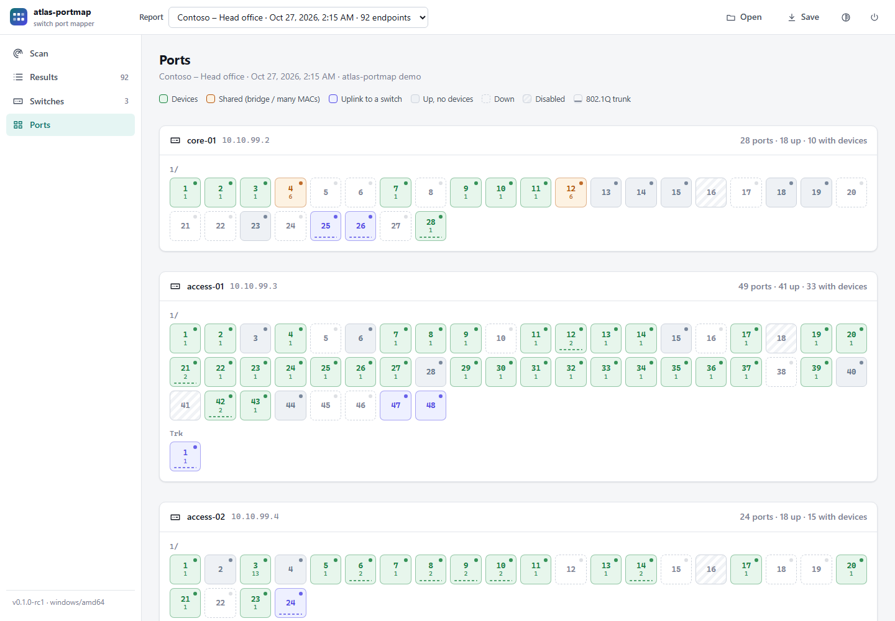
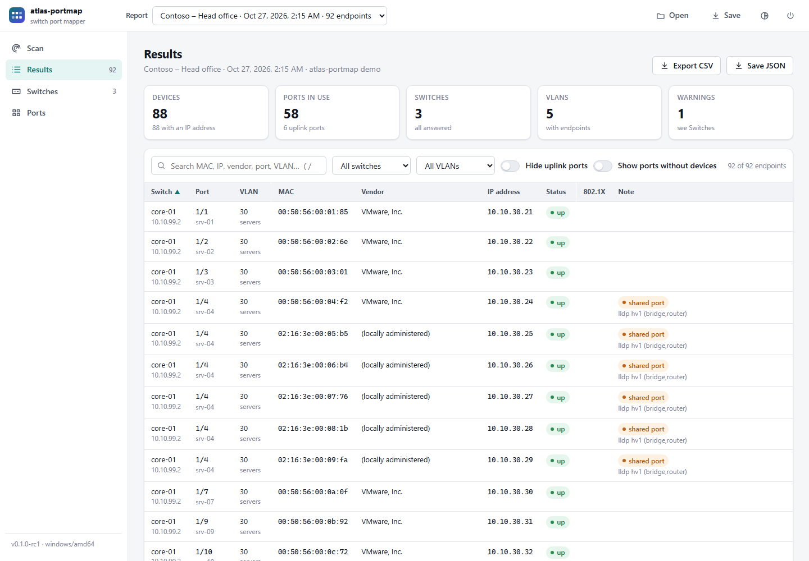
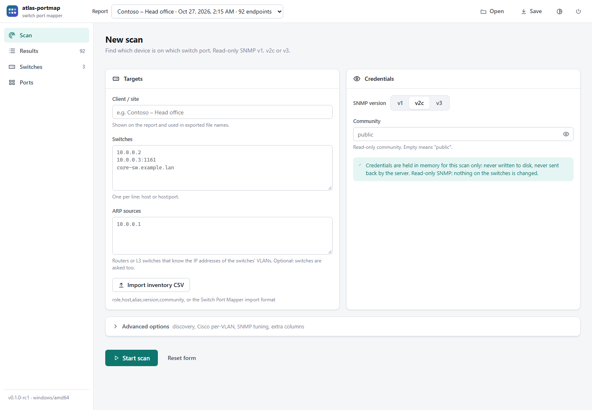
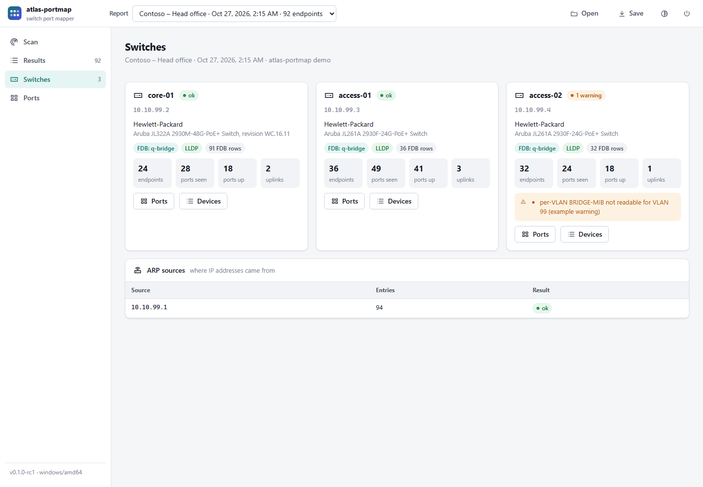
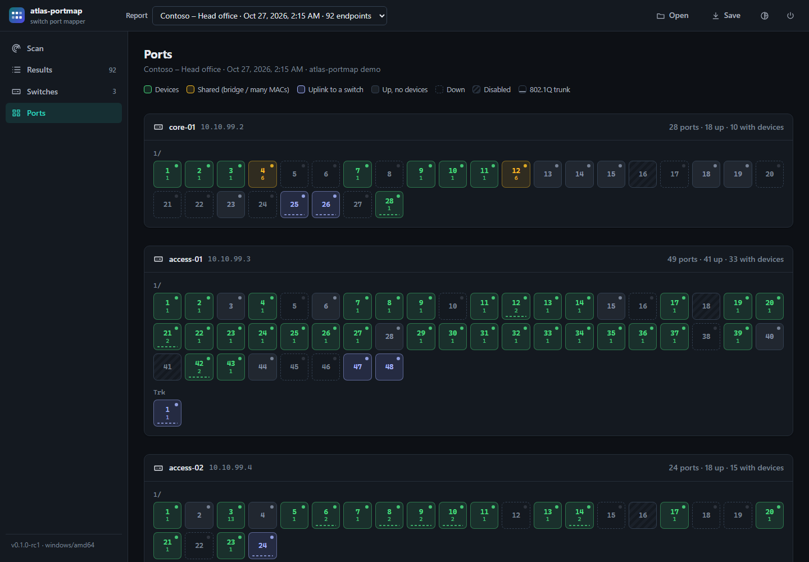

# atlas-portmap

Maps switch ports to the devices behind them over SNMP: which MAC, IP address, hostname and vendor
sits on which port and VLAN, across a group of switches. One static binary for Linux, Windows and
macOS, with a local web GUI and a command line; read-only SNMPv1/v2c/v3; no agent, no database.



```text
SWITCH        PORT            ALIAS      VLAN  MAC                VENDOR                   IP                 STATUS  NOTE
core          Gi1/0/1         srv-01     10    00:50:56:00:00:0a  VMware, Inc.             10.0.10.5          up      -
core          Gi1/0/2         to-access  1     00:00:0c:aa:aa:aa  Cisco Systems, Inc       -                  up      uplink: faces access; lldp access.lab.example port ge-0/0/24 (bridge)
core          Gi1/0/4         vm-host    30    02:00:00:00:00:01  (locally administered)   -                  up      -
access        ge-0/0/1        -          20    b8:27:eb:00:00:0b  Raspberry Pi Foundation  10.0.20.6,fe80::1  up      -
access        ge-0/0/2        -          20    00:15:5d:00:00:0d  Microsoft Corporation    10.0.20.8          up      lldp SEP0000C000000C port Port 1 (bridge,phone)
access        ge-0/0/24       -          1     00:00:0c:cc:cc:cc  Cisco Systems, Inc       -                  up      uplink: faces core; lldp core port Gi1/0/2 (bridge,router)
closet-cisco  Gi1/0/1         -          10    00:1b:63:00:01:01  Apple, Inc.              10.0.1.50          up      -
closet-cisco  Gi1/0/48        -          -     00:00:0c:00:0f:01  Cisco Systems, Inc       -                  up      uplink: faces core; cdp core.lab.example port 1/1/48 [Aruba JL322A 2930F] (bridge,router)
```

(Real output, abridged, from the end-to-end test's simulated network: a Q-BRIDGE core, a BRIDGE-MIB
access switch below it, a Cisco switch with per-VLAN instances, and a router holding the ARP table.)

## Download

Pre-built binaries are on the [Releases](https://github.com/orionparker33/atlas-portmap/releases)
page: one archive per platform with the binary, `LICENSE` and `THIRD_PARTY_NOTICES`, plus
`SHA256SUMS`. Check the checksum before running a download (`sha256sum -c SHA256SUMS
--ignore-missing` on Linux, `Get-FileHash` in PowerShell). The binaries are not code-signed yet, so
Windows SmartScreen or endpoint protection may warn. Other platforms build from source with Go 1.24+
(`make build`), or `go install github.com/orionparker33/atlas-portmap/cmd/atlas-portmap@latest`.

## Quick start

```sh
make build                                   # bin/atlas-portmap (Go 1.24+)
bin/atlas-portmap gui                        # local web GUI (also what a double-click starts)
export PORTMAP_COMMUNITY=$(op read 'op://<vault>/<item>/community')   # or any secret store
bin/atlas-portmap -arp 10.0.0.1 10.0.0.2 10.0.0.3          # switches as arguments, router for ARP
bin/atlas-portmap -inventory examples/devices.csv -o json > map.json
bin/atlas-portmap -all-ports -resolve core-sw.lab          # include free ports, reverse DNS
```

SNMPv3 (authPriv):

```sh
export PORTMAP_V3_USER=mapper PORTMAP_V3_AUTH_PASS=… PORTMAP_V3_PRIV_PASS=…
bin/atlas-portmap -v 3 -v3-auth-proto sha256 -v3-priv-proto aes 10.0.0.2
```

The community and SNMPv3 passphrases are read from `PORTMAP_COMMUNITY`, `PORTMAP_V3_AUTH_PASS` and
`PORTMAP_V3_PRIV_PASS`, the SNMPv3 user from `PORTMAP_V3_USER` or `-v3-user`. The matching flags
for the secrets exist but print a warning: command-line arguments show up in process listings and
shell history. The community and passphrases are never printed. The SNMPv3 user name is not secret
(it travels in clear text in every SNMPv3 message) and appears in error hints and reports.

| Command | Purpose |
|---|---|
| `atlas-portmap gui [-open report.json]` | Local web GUI. Started with no arguments on a desktop, the binary opens it. |
| `atlas-portmap [map] [flags] [switch …]` | Map switches from the command line. `map -h` lists every flag. |
| `atlas-portmap walk [flags] HOST [OID …]` | Walk OIDs on a device, for diagnosing a switch that maps badly. |
| `atlas-portmap vendor MAC\|sysObjectID …` | Look up a MAC vendor (IEEE) or an SNMP enterprise (IANA). |

Useful `map` flags: `-label "Client – site"` (recorded in the report and export names), `-progress`
(per-device progress on stderr), `-arp HOST` (routers/L3 devices to read ARP from, repeatable), `-inventory FILE`,
`-o table|json|csv`, `-all-ports` (list free ports and uplinks too), `-all-sightings` (every port
that learned each MAC, not just its location), `-resolve` (reverse DNS), `-dot1x` (802.1X port
control column), `-column NAME=OID` (any per-port value indexed by ifIndex, e.g.
`-column duplex=1.3.6.1.2.1.10.7.2.1.19` or `-column lastchange=1.3.6.1.2.1.2.2.1.9`; tables indexed
by anything else, such as PoE's group.port, are reported as such), `-cisco-per-vlan auto|on|off`, `-vlans 1,10-20`,
`-uplink-threshold N`, `-local-arp`, `-mac-format colon|dash|dot|bare`.

Exit status:

| Code | Meaning |
|---|---|
| 0 | Complete: every switch and ARP source answered in full. |
| 1 | Nothing mapped: no switch answered. |
| 2 | Usage error. |
| 3 | Partial: a switch failed or stopped part-way, an ARP source failed, or the run was interrupted. The output covers what was read. |

Failed devices are always reported on stderr, one `error:` line each with what to check and the
raw cause; `-q` drops only warnings. A switch that answered and then stopped is reported as
`PARTIAL`: its rows are in the output but incomplete. JSON output adds per-switch summaries (FDB
source, LLDP presence, `partial`, warnings, `error`, `error_kind`, `hint`) and per-ARP-source
counts. Flags may come before or after the switch addresses.

### When a device fails

`error_kind` (JSON, GUI) classifies the failure and `hint` says what to check:

| `error_kind` | Meaning |
|---|---|
| `no-response` | Nothing answered. v1/v2c agents drop a wrong community without replying, so this is also what a wrong community looks like (with no `-c` or `PORTMAP_COMMUNITY`, `public` is used). Otherwise: SNMP disabled (Cisco Small Business: `snmp-server server`), wrong `-v`, an SNMP access list or a firewall. For SNMPv3 it means engine discovery went unanswered; for a switch that answered earlier, that it stopped part-way. |
| `v3-no-response` | SNMPv3 discovery answered, the authenticated request did not: some agents drop wrong credentials silently. |
| `port-closed` | ICMP port unreachable: no agent on the port, or a firewall rejecting (Linux, macOS; on Windows this shows as `no-response`). |
| `auth-failed` | The SNMPv3 reply failed authentication and the agent did not say why: wrong user, auth passphrase or protocol, or privacy protocol. Some agents offer only DES privacy (Cisco Small Business Sx300/Sx500 on 1.4.x firmware): try `-v3-priv-proto des`. |
| `unknown-user`, `wrong-digest`, `decryption`, `security-level`, `time-window` | The cause the agent named in its usmStats Report (RFC 3414). The Report is unauthenticated, so this is a diagnosis, not proof. |
| `access-denied` | The agent answered `authorizationError` or `noAccess` to the first request: this community or SNMPv3 user may not read. Below authPriv the group probably needs a higher level (`-v3-auth-proto`, `-v3-priv-proto`); at authPriv, check the group's read view and `-v3-context`. A refusal of one table later on is only a warning. |
| `cancelled`, `other` | Interrupted or past `-deadline`; anything else (see `error`). |

The first request to a device goes out once before any retries, so wrong SNMPv3 credentials cost
one authentication failure on the agent (each can raise an authenticationFailure trap at the
client's NOC); a silent agent still gets `-retries`. `walk` stops at the first no-response,
authentication failure or interruption and says how many OIDs it skipped.

## GUI

`atlas-portmap gui` serves a single-page app from the binary on `127.0.0.1` (random port) and
opens the browser. Everything is embedded; nothing is fetched from the internet, so it works on an
isolated client network.

| View | What it shows |
|---|---|
| Scan | Targets (switches, ARP sources, or an inventory CSV), credentials, options; live per-device progress |
| Results | Summary tiles; the port map as a searchable, sortable table; a details drawer per row; CSV / JSON export |
| Switches | One card per switch: vendor, FDB source, LLDP, counts, warnings and errors; ARP sources |
| Ports | Each switch as a faceplate: devices, shared ports, uplinks, trunks, idle, down and disabled ports at a glance |



| Scan | Switches | Ports (dark theme) |
|---|---|---|
|  |  |  |

Reports: scans stay in the session's report list until the GUI stops (up to 100; beyond that the
oldest report opened from a file goes first, then the oldest scan). **Save** writes a report as JSON
and **Open** (or `gui -open file.json`) loads it again, so keep one file per client visit.

To use the GUI on another machine, forward it over SSH (`ssh -L 8765:127.0.0.1:8765 host`, then
`atlas-portmap gui -addr 127.0.0.1:8765` on that host). A non-loopback `-addr` is refused unless
`-allow-remote` is given, because the GUI speaks plain HTTP and the token and typed credentials
would cross the network unencrypted.

Security model, because the GUI handles SNMP credentials:

- Loopback only (see above). Every API call needs the 256-bit session token printed at start; it
  travels in a custom header, so a web page in another tab cannot send it (and cannot read it).
- The browser is opened through a private redirect file, so the token never appears on a command
  line that other local users could read.
- The `Host` header must name the listener (DNS-rebinding defence); writes also check `Origin` and
  `Sec-Fetch-Site` and require JSON. A strict Content-Security-Policy allows only the app's own
  scripts and styles.
- Credentials typed into the form are held in memory for the scan and never written to disk or
  returned by the API. Leave them empty to use the `PORTMAP_*` variables of the process that
  started the GUI. All device-supplied text is rendered as text, never as HTML.

Extending it: the front end is plain ES modules in `internal/gui/web/js` (no build step, no npm).
A new screen is a file in `views/` exporting `render(container)` plus one `registerView(...)` line
in `app.js`; the API is in `internal/gui/server.go` and drives the same `internal/engine` as the CLI.
`make gui-demo` opens the GUI on a generated demo site for UI work.

### Inventory files

One device per line, header optional, `#` comments. Two layouts are accepted per line:

```text
role,host,alias,version,community        # role: switch or arp (router is an alias for arp)
host,alias,version,read_community[,write]  # Switch Port Mapper's import format; role switch
```

Empty `version`/`community` fall back to the command line. See `examples/devices.csv`.

## How it maps

A switch port map is one join across four standard MIBs. These are the tables read, all from
published RFC/IEEE MIBs (`internal/mib/oids.go` cites each):

| Step | Table (MIB) | Gives |
|---|---|---|
| MAC → bridge port | `dot1qTpFdbTable` (Q-BRIDGE-MIB, RFC 4363), else `dot1dTpFdbTable` (BRIDGE-MIB, RFC 4188) | learned addresses; Q-BRIDGE also the VLAN (via `dot1qVlanFdbId`) |
| bridge port → ifIndex | `dot1dBasePortIfIndex` (BRIDGE-MIB) | the interface |
| ifIndex → port | `ifName`, `ifDescr`, `ifAlias`, status, speed (IF-MIB, RFC 2863) | port name, description, state |
| port mode | `dot1qVlanCurrentEgressPorts` / `…UntaggedPorts` (Q-BRIDGE-MIB) | access, trunk (tagged VLANs, native VLAN) or hybrid (several untagged VLANs); an access port's VLAN, for ports with no devices and for forwarding entries that carry no VLAN |
| VLAN when neither the FDB nor membership has one | `dot1qPvid` (Q-BRIDGE-MIB) | the port's native VLAN (a guess) |
| MAC → IP | `ipNetToPhysicalTable` (IPv4+IPv6), `ipNetToMediaTable` (IP-MIB, RFC 4293) on routers / L3 switches | addresses |
| uplinks | `lldpRemTable` (LLDP-MIB, IEEE 802.1AB), `cdpCacheTable` (CISCO-CDP-MIB) | neighbour switches, phones, APs |
| MAC → vendor | IEEE MA-L/MA-M/MA-S/IAB registry (embedded) | organisation, longest-prefix match |
| switch → vendor | sysObjectID enterprise number, IANA registry (embedded) | organisation |

Vendor quirks handled:

- **Cisco IOS per-VLAN bridge instances.** IOS answers BRIDGE-MIB for one VLAN at a time; the
  instance is selected with community `community@VLAN` (v1/v2c) or context `vlan-VLAN` (v3). VLANs
  come from CISCO-VTP-MIB (or `-vlans`). Default-instance addresses that no per-VLAN walk saw are
  kept, so a VLAN whose instance cannot be read loses nothing. Denied, empty and silent instances
  are each reported (the usual cause is an SNMPv3 group without `vlan-` contexts), and after four
  timeouts with no instance answering the rest are skipped rather than waited out. A Cisco switch
  whose CISCO-VTP-MIB is unreadable is reported as VLAN-1-only. CISCO-STACK-MIB `portName` fills
  empty `ifAlias` values on CatOS/older IOS.
- **LLDP local port numbering.** 802.1AB says `lldpRemLocalPortNum` is the bridge port, but agents
  differ. The local port is matched by its LLDP port ID or description against IF-MIB names first
  (with `GigabitEthernet1/0/1` = `Gi1/0/1` abbreviation), then a numeric `local` port ID as ifIndex,
  then bridge port, then ifIndex.
- **Shared VLAN learning.** When several VLANs share one FDB ID the VLAN comes from the port PVID
  (with a warning).
- **Agents that mishandle GETBULK.** Tables are walked with GETBULK and every reply's error-status
  is checked. `tooBig` halves the bulk size; any other error (genErr, noAccess,
  authorizationError, …) or a non-increasing OID retries the table with GETNEXT; an agent that
  answers GET but ignores GETBULK is switched to GETNEXT for the rest of the run. Rows read before
  a failure are kept and the table is reported as incomplete, never silently truncated.
  `-max-reps` sets the starting bulk size.
- **Juniper (Junos ELS).** Q-BRIDGE-MIB numbers VLANs by an internal index; JUNIPER-L2ALD-VLAN-MIB
  (or JUNIPER-VLAN-MIB) maps it and the FDB ID to the 802.1Q tag. On any vendor, FDB IDs outside
  1-4094 with no FDB-to-VLAN table are not taken as VLANs.
- **Cisco Small Business (SG300, firmware 1.4).** SNMP is off until `snmp-server server`; SNMPv3
  users need a local engine ID first (`snmp-server engineID local default`), and privacy is DES
  only, so use `-v3-priv-proto des` (an AES request comes back as a `time-window` failure, which the hint
  explains). A read-only setup that works:
  `snmp-server group RO v3 priv read Default` plus
  `snmp-server user NAME RO v3 auth sha AUTHPASS priv PRIVPASS`. VLAN interfaces are named by bare
  number (`50`); the switch's own MAC sits in the FDB on bridge port 0 and is skipped.
- **Cisco Small Business SG350 (firmware 2.5).** `dot1qPvid` reads 1 on every port, whatever the
  port's VLAN. VLAN membership (`dot1qVlanCurrentTable`) is right, so it wins: an access port's VLAN
  and a trunk's native VLAN come from membership, with a warning that the PVIDs disagree.
- **Link aggregates and logical units.** IF-MIB `ifStackTable` and IEEE8023-LAG-MIB tie physical
  ports to the LAG (or Junos `ge-0/0/1.0` unit) that holds the forwarding entries, so an LLDP/CDP
  neighbour heard on a member marks the aggregate as an uplink. Member ports carry `member_of`.

### Placing each MAC

In a group of cascaded switches an address is learned on its edge port *and* on every uplink
between that port and each other switch. Each MAC is reported once, at its best sighting:

1. A port that provably faces another mapped switch is never chosen when the MAC was seen anywhere
   else. "Provably": an LLDP/CDP neighbour that is one of the mapped switches (by sysName, and only
   when no other mapped switch shares that name; the chassis MAC wins a conflict), or a learned
   address that is a mapped switch's own MAC (its bridge base MAC, or the MAC of the address it was
   reached at, from ARP). The last two work without LLDP.
2. Otherwise the port with the fewest learned MACs wins: the port nearest a device sees a subset of
   what every port upstream of it sees. That holds per VLAN (a pruned trunk carries fewer VLANs), so
   when both sightings have FDB-reported VLANs the count is taken in the shared VLAN.
3. Heuristic "shared" ports only break ties: a neighbour advertising bridge/router capability
   that is not a phone or AP (a hypervisor running lldpd, say), or at least `-uplink-threshold`
   MACs (default 10) on a port whose neighbour is not an AP or phone. The devices behind a shared
   port are still reported there, because that is where they are.

`uplink_kind` in JSON/CSV says which: `switch` for a true uplink (faces another mapped switch),
`bridge` or `many-macs` for a shared port. The GUI colours them differently.

`vlan_source` says where a row's VLAN came from: `fdb` (the switch's forwarding table),
`fdb-other-switch` (this switch only knew the port PVID, another switch's table had the real VLAN),
`port` (the port's configured access VLAN, from live VLAN membership: used for a port with no
devices, and for a device whose forwarding entry carried no VLAN) or `pvid` (a guess when membership
says nothing better: tagged traffic shows the port's native VLAN).

`port_mode` is `access`, `trunk` (with `tagged_vlans` and `native_vlan`) or `hybrid` (several
untagged VLANs), from the switch's live VLAN membership. The table notes trunks as
`trunk: tagged 50,60; native 1`.

### IP addresses per VLAN

A firewall or router on a trunk, an SVI or a reused VRRP/HSRP MAC answers on several VLANs with one
MAC, so addresses join per MAC *and* VLAN. Each ARP binding gets the VLAN it was learned in when
that can be told: from the router's VLAN interface name (`50`, `Vlan50`, `Vl50`, `VLAN50`,
`Vlanif50`, `Vlan-interface50`; propVirtual, l2vlan or l3ipvlan interfaces only), from this
machine's own MAC on the interface the local cache entry came from (`-local-arp`), or from the
other addresses on the same interface when the forwarding table puts every one of them in one VLAN
(a binding's own MAC never votes for it, and two such addresses are needed to overrule a name).
A binding then shows only on the row of its VLAN. A binding whose VLAN is unknown shows as before
on a MAC with one VLAN; on a MAC with several it is listed under `other_ips` as `ip (VLAN ?)`
instead of being claimed by every row, and one known to be in a VLAN this MAC has no row for (an
aged-out entry) is listed as `ip (VLAN n)`. Rows whose VLAN is itself a PVID guess keep every
address.

`-all-sightings` shows every port that learned a MAC (secondary rows marked); each row also lists
the other ports in `also_seen`.

## Limitations

- **Tested on three real switches so far:** a Cisco SG300-10 (firmware 1.4.11.2, L2 mode, SNMPv3
  SHA/DES), whose anonymized recording is part of the end-to-end suite
  (`e2e/testdata/sg300-10.snmprec`, made with `tools/walk2snmprec`), and two cascaded Cisco
  SG350-28 (firmware 2.5.8.15, SNMPv2c, LLDP and CDP). Everything else is tested against an SNMP
  simulator (snmpsim). Validate on a lab switch of each family before trusting a map.
- An address appears only while it is in the forwarding table (aging is typically 300 s) and has an
  IP only while it is in some ARP table. There is no ping sweep; `-local-arp` adds this machine's
  neighbour cache.
- MACs learned on a link aggregate are reported on the port-channel, not the member link (members are
  listed with `member_of`).
- A MAC is reported at one location. The rare MAC that sits in two VLANs at two different ports
  (some HA virtual MACs) is shown at the better of the two; `-all-sightings` lists both.
- Where no switch's forwarding table reports a MAC's VLAN, an access port gives its configured VLAN
  (`vlan_source=port`); otherwise the VLAN is the port's native VLAN or PVID (`vlan_source=pvid`),
  which is wrong for tagged traffic on trunks.
- Vendor-proprietary forwarding tables are not read: devices that implement neither BRIDGE-MIB nor
  Q-BRIDGE-MIB FDB tables (some Extreme/Avaya lines; H3C/HPE Comware may need its hh3c MIBs, Huawei
  its L2MAM) map no addresses. The LLDP-V2-MIB tree is not read, only LLDP-MIB.
- Cisco per-VLAN collection over SNMPv3 needs the device's SNMP group to allow `vlan-` contexts
  (`snmp-server group NAME v3 priv context vlan- match prefix`).
- `-local-arp` on Windows reads IPv4 only (`arp -a`).
- The GUI runs one scan at a time and keeps reports only for the session; save the JSON to keep one.

## Roadmap

[`docs/roadmap.md`](docs/roadmap.md) is a researched, prioritised plan for an engineer who works
across many client sites: field safety on real switches first (SNMP doctor with capture/replay,
polling presets, "where am I plugged in?", read-only port locate), then client workspaces with
scoped credential references, a scope guard and encryption at rest, then visit-to-visit diffs,
port health and a client deliverable. It ends with open design questions.

## Development

```sh
make test       # unit tests
make race       # unit tests under the race detector (needs cgo, i.e. a C compiler)
make vet        # go vet (including the e2e package) and gofmt
make e2e        # end-to-end: race-built binary vs snmpsim (needs python3 with venv and PyPI on first run; E2E_NO_RACE=1 builds without -race)
make dist       # static binaries: linux/amd64, linux/arm64, windows/amd64, windows/arm64, darwin/arm64
make data       # refresh the embedded IEEE/IANA data (internal/vendordb/data/SOURCES.txt records it)
make jscheck    # syntax-check the GUI's ES modules (needs node)
make gui-demo   # build a demo site report (tools/demoreport) and open it in the GUI
```

The end-to-end test also drives the GUI: it starts `atlas-portmap gui`, runs a scan through its API
against snmpsim, checks the result and the Host guard on the real listener, and quits it. The
screenshots in `docs/img` are the Windows build rendered by headless Edge.

| Package | Role |
|---|---|
| `cmd/atlas-portmap` | CLI: commands, flags, exit codes |
| `internal/engine` | one mapping run: plan, parallel collection, join, report; progress events (CLI and GUI) |
| `internal/gui` | local web server and API (`server.go`), embedded single-page app (`web/`) |
| `internal/snmpc` | gosnmp sessions: v1/v2c/v3, per-VLAN instances, error-status-checked table walks with GETNEXT fallback, cancellation |
| `internal/snmptest` | in-process fake SNMPv1/v2c agent with fault injection, for tests |
| `internal/mib` | OID catalogue, row-index decoders, value rendering (control characters never pass through raw) |
| `internal/collect` | reads one switch (or ARP source); LLDP/CDP decoding and local-port resolution |
| `internal/portmap` | the join and MAC placement |
| `internal/vendordb` | embedded IEEE OUI / IANA PEN lookups; `tools/gendata` regenerates the data |
| `internal/output` | table (terminal-escape safe), JSON, CSV (formula-injection safe) |
| `internal/inventory`, `internal/localarp` | device lists; OS neighbour caches (Linux, Windows, macOS/BSD) |
| `e2e` | end-to-end test against snmpsim (`go test -tags e2e`), CLI and GUI |
| `tools/gendata`, `tools/demoreport` | registry data generator; demo report for GUI work |
| `tools/walk2snmprec` | turns a `walk` capture from a real device into an anonymized snmpsim fixture |

Dependencies: Go standard library and `github.com/gosnmp/gosnmp` (BSD; see `THIRD_PARTY_NOTICES`).

## Provenance

An independent implementation written from the public MIB specifications (RFC and IEEE MIBs,
vendor MIBs cited in `internal/mib/oids.go`). Its feature scope follows what field engineers expect
from switch port mapping tools in general: forwarding tables, ARP from routers, LLDP/CDP neighbours,
Cisco per-VLAN instances, 802.1X state, custom per-port columns and vendor lookup. The inventory
reader also accepts the common `host,alias,version,read_community` import format for
interoperability. The vendor data is generated from the IEEE and IANA registries by
`tools/gendata`.

## License and use

MIT; see `LICENSE`. Third-party components keep their own licenses (`THIRD_PARTY_NOTICES`). SNMP
reads are read-only, but only point the tool at networks you own or are authorized to manage.
Security reports: see `SECURITY.md`; contributions and device captures: `CONTRIBUTING.md`.

Product and company names mentioned in this repository (for example Cisco, Juniper, Aruba,
SolarWinds and Switch Port Mapper) are trademarks of their respective owners. They are used only to
identify compatible equipment, file formats and cited sources; atlas-portmap is an independent
project, not affiliated with or endorsed by any of them.
